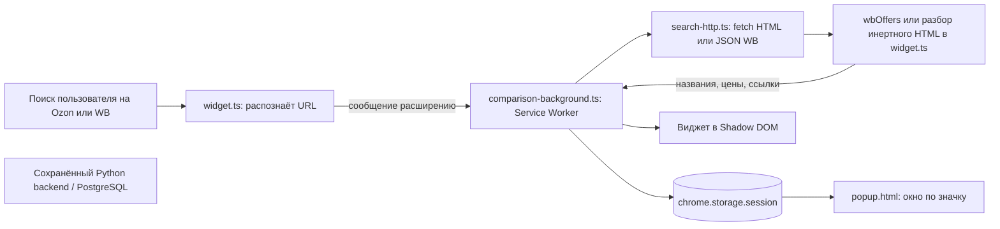
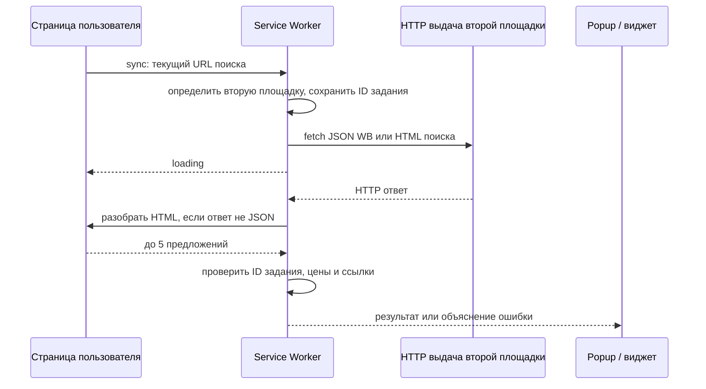

# Расширение «Сравнить цены»

**Текущая доводка — браузерный режим, версия 0.3.1.** Исправлено падение popup при отсутствии настроек от старого Service Worker. Используются обе открытые вкладки Ozon и WB без изменения их адресов. В popup добавлена кнопка «Скачать диагностику браузера». Какие примеры нужны для проверки на вашем Chrome: [BROWSER_DIAGNOSTICS.md](BROWSER_DIAGNOSTICS.md).

Ищите на Ozon или Wildberries как обычно. Расширение распознаёт запрос в адресе страницы, запрашивает данные второй площадки по HTTP и показывает до пяти предложений: название, цену и ссылку на карточку. Результаты появляются в маленьком виджете справа сверху и в окне по значку расширения. Автоматического открытия страниц, переключения вкладок и изменения текущего адреса нет.

## Установка в ваш Chrome

Нужен Node.js 24+ для сборки. Для использования уже собранной папки Node не нужен.

```powershell
Set-Location 'E:\Baumanka\parser\JS'
npm.cmd ci
npm.cmd run typecheck
npm.cmd run build
```

1. Откройте `chrome://extensions` и включите «Режим разработчика».
2. Нажмите «Загрузить распакованное расширение» и выберите `E:\Baumanka\parser\JS\dist`.
3. Закрепите значок через меню расширений Chrome.
4. Перезагрузите уже открытые вкладки Ozon и Wildberries.
5. Например, выполните поиск «Sony WH-1000XM5» на Ozon. Справа появится виджет «Ozon → Wildberries», сначала с состоянием поиска, затем с карточками WB.

Для WB Service Worker запрашивает JSON поисковой выдачи, затем при необходимости HTML. Для Ozon сначала используется сессия уже открытой вкладки и JSON Composer API; если такой вкладки нет, пробуются прямые JSON/HTML-запросы. Чужой HTML не вставляется в страницу. Для JSON WB сейчас используется регион API по умолчанию; его цена и доставка могут отличаться от вашей страницы — это указано у предложения.

### Ozon и HTTP 403: версия 0.2.2

Для WB → Ozon расширение сначала использует **уже открытую вкладку Ozon**, не переключая и не перенаправляя её. Если нужная выдача уже открыта, читаются готовые карточки. Иначе content script этой вкладки запрашивает JSON Composer API или HTML по тому же origin с существующей сессией. Это отличается от прямого запроса Service Worker: content scripts выполняют запросы от origin страницы, как описано в [документации Chrome](https://developer.chrome.com/docs/extensions/develop/concepts/network-requests).

После обновления расширения нажмите «Обновить» на `chrome://extensions`, затем перезагрузите вкладки WB и Ozon. Если Ozon ещё не открыт, откройте его вручную один раз; при необходимости пройдите проверку. Оставьте вкладку открытой, вернитесь на WB и нажмите «Повторить» в виджете. Расширение само вкладок не создаёт и адрес открытой вкладки Ozon не меняет. Пароли и cookies не экспортируются.

Если доступной вкладки нет, пробуются прямой JSON и HTML запросы. Если Ozon отклоняет также запрос из открытой вкладки, расширение сообщает об этом. Универсального обхода 403/CAPTCHA код не гарантирует. Поддержаны текущие `tileGridDesktop` / `textDS` и прежние `searchResultsV2` / `textAtom`; зачёркнутая цена не подставляется вместо текущей.

Проверить новый способ в тестовом Chromium: `node scripts/widget-live.mjs --ozon-session`, отчёт — `test-results/ozon-session-live.json`. Проверка production-модуля в обычном Chrome: `node scripts/ozon-native-probe.mjs`. Для неё требуется уже установленное Python-окружение проекта; используется отдельный профиль `backend/data/ozon-chrome-session`, основной пользовательский профиль Chrome не затрагивается. Отчёт с товарами и HTTP-статусами — `test-results/ozon-native-session-live.json`; cookies и содержимое аккаунта не сохраняются. Эта проверка не требует запущенного сервера.

После изменения исходников повторите `npm.cmd run build`, нажмите «Обновить» на карточке расширения и перезагрузите страницы площадок. Удалять расширение и его данные не требуется.

## Альтернативный источник: Backend, версия 0.3.0

В popup откройте «Источник данных» → «Через backend». Укажите адрес API (локально `http://127.0.0.1:8000`) и token, нажмите «Проверить сервер» и «Сохранить». Пустой token означает `local-development-token`. Существующий браузерный способ остаётся доступным в том же списке.

В этом режиме расширение отправляет запрос на сервер, показывает очередь/выполнение и выводит сохранённые в PostgreSQL цены и ссылки. При смене запроса отменяет серверное задание. Открытая вкладка Ozon в пользовательском браузере не нужна; сервер использует отдельный профиль Chrome. Пользовательские вкладки не создаются и не перенаправляются. Время ожидания backend — до 180 секунд.

**Запуск нативного сервера Windows, Docker, схема API, настройки и проверки:** [backend/EXTENSION.md](../backend/EXTENSION.md). Для Ozon сервер получил engine `chrome-session`, для WB используется существующий Selenium-парсер. Блокировка на сервере показывается как ошибка backend; это не гарантия обхода CAPTCHA.

## Как пользоваться

- Поиск запускается после перехода на страницу выдачи, а не при каждом введённом символе. Поддержаны Ozon `/search/?text=...`, `/category/.../?text=...` и WB `/catalog/0/search.aspx?search=...`.
- Смена запроса без перезагрузки страницы тоже распознаётся. Повторные события того же запроса не открывают новые вкладки.
- Кнопка `−` сворачивает виджет; `×` скрывает его до следующего запроса. Скрытие виджета не отменяет текущий поиск: результат остаётся доступен по значку.
- «Повторить» запускает запрос заново. «Открыть поиск» открывает обычную страницу второй площадки.
- Значок расширения показывает результаты для активной вкладки. Переключатель «Авто» включает и выключает автоматический поиск; выключение отменяет текущие фоновые поиски.
- При уходе со страницы поиска или закрытии исходной вкладки соответствующий фоновый поиск отменяется.

На сетевой запрос отведено 25 секунд. Chrome Alarm срабатывает через 60 секунд, если выполнение прервалось. Одновременно разрешено до трёх сравнений из разных исходных вкладок; новый запрос сверх лимита останавливает самый старый незавершённый поиск.

## Устройство



Сервер существует отдельно и не участвует в этом сценарии. Запуск Python или Docker не требуется. Загруженный HTML разбирается в отдельном документе через DOMParser и не вставляется в страницу пользователя. Если карточки появляются только после исполнения JS или площадка блокирует запрос, расширение показывает ошибку. Автоматического перехода на площадку даже при ошибке нет.



При смене запроса старый HTTP-запрос отменяется через AbortController, а его запоздавший результат игнорируется по ID задания. Операции координатора последовательно выполняются через одну очередь Promise. Встречный поиск не возникает: страница второй площадки не открывается и её content script не запускается.

Виджет использует Shadow DOM: его стили изолированы от оформления магазина. Названия и сообщения вставляются через `textContent`, ссылки проверяются по домену и формату карточки. Данные карточки не вставляются как HTML.

## Где хранятся данные

| Данные | Хранилище | Срок |
|---|---|---|
| Включён ли автопоиск | `chrome.storage.local`, `comparisonEnabled` | До изменения настройки или удаления расширения |
| Источник, адрес backend и token | `chrome.storage.local`, `comparisonBackend`, только доверенные контексты | До изменения настройки или удаления расширения |
| Запросы, до 5 карточек, состояние | `chrome.storage.session`, `comparisons` | Пока работает сессия браузера; удаляются при закрытии исходной вкладки |
| Результаты прежнего локального сборщика | Существующая SQLite OPFS | Сохранены отдельно, новый виджет их не меняет |
| Серверные товары и задания | Существующая PostgreSQL backend | Сохранены отдельно |

Виджет не создаёт долговременную историю поисков. Выгрузка Service Worker не стирает состояние: при пробуждении он читает `storage.session`, а тайм-ауты обслуживает Chrome Alarms. Полный перезапуск браузера, перезагрузка или отключение расширения очищают session-хранилище; восстановление незавершённых сравнений между такими запусками не предусмотрено.

Новый сценарий не запускает SQLite. В манифесте оставлены разрешения и ресурсы прежних инструментов: их локальная БД, сбор и серверный клиент сохранены для совместимости.

## Важные файлы и функции

| Файл / функция | За что отвечает |
|---|---|
| `manifest.json` | MV3, домены площадок, автоматическое подключение `widget.js`, popup по значку |
| `comparison.ts / searchContext()` | Проверяет площадку и путь выдачи, извлекает и нормализует запрос |
| `comparison.ts / partnerSearch()` | Строит адрес поиска другой площадки с тем же текстом |
| `comparison-background.ts / sync(), runHTTP()` | Устраняет повторные запуски, создаёт задание и выполняет HTTP-поиск |
| `comparison-background.ts / finish(), stop()` | Сохраняет результат, отменяет HTTP-запрос, снимает тайм-аут и обновляет интерфейс |
| `widget.ts / sync()` | Проверяет URL раз в секунду, в том числе после SPA-навигации |
| `search-http.ts / searchHTTP(), wbOffers()` | Запрашивает выдачу, разбирает современный и прежний JSON WB; переводит целые копейки в рубли |
| `ozon-session.ts / searchFromOzonPage(), ozonJSONOffers()` | Использует origin открытой вкладки Ozon, разбирает только товарные плитки поиска из widgetStates Composer API |
| `widget.ts / comparison-parse` | Разбирает HTML в инертном документе и обнаруживает блокировку |
| `listing.ts / listingOffers()` | Ищет контейнер одной карточки, извлекает её собственные название, цену и каноническую ссылку |
| `comparison.ts / validOffer()` | Проверяет формат положительной цены и ссылку на карточку нужной площадки |
| `comparison-view.ts / renderComparison()` | Общий безопасный вывод состояний и карточек для виджета и popup |
| `popup.ts` | Получает результат активной вкладки, управляет переключателем и повтором поиска |
| `background.ts` | Подключает новый координатор и сохраняет прежний сборщик/API-клиент |
| `scripts/build.mjs` | Собирает исходники и ресурсы в `dist` |

`listingOffers()` не связывает глобальный список всех цен со списком всех ссылок по индексам. Она ограничивает поиск контейнером одного товара, отвергает контейнеры с несколькими разными карточками и удаляет дубликаты ссылок. При неизвестной разметке без цены предложение не показывается.

## Ограничения цен и доступа

Это сравнение **выдачи по одинаковому запросу**, а не подтверждение идентичности товаров. Проверьте модель, комплектацию, продавца и доставку в карточке. Порядок результатов соответствует выдаче магазина, а не сортировке по минимальной цене.

Показываются цены из HTTP-ответа выдачи. Они могут зависеть от региона, аккаунта, карты Ozon или кошелька WB. У JSON WB регион API по умолчанию; данные ответа не равнозначны вашей персональной цене. Виджет добавляет пояснение об условиях. Итоговая цена при оформлении заказа может отличаться.

Если площадка показывает CAPTCHA или отказ в доступе, виджет сообщает об этом. Откройте поиск вручную, пройдите проверку и нажмите «Повторить» на исходной странице. Код не гарантирует обход 403. При изменении HTML магазина может потребоваться обновить селекторы в `listing.ts`.

Пока браузер закрыт, сравнения не выполняются. Данные собираются только с первой выдачи: пагинация, массовый обход карточек и серверное расписание не входят в новый автоматический сценарий. Внутренний поисковый JSON API WB может менять адрес или формат; при этом потребуется обновление `search-http.ts`.

## Запуск и проверки

```powershell
Set-Location 'E:\Baumanka\parser\JS'
npm.cmd run typecheck
npm.cmd test
npm.cmd run test:widget
```

`test:widget` запускает Chromium с настоящим расширением. Локальный HTTPS-прокси возвращает контролируемые HTML и JSON: проверяются оба направления, Ozon category search, цены, отсутствие новых вкладок и изменений исходного адреса, SPA, CAPTCHA, повтор, переключатель, popup и отмена. Это проверка механизма расширения, а не доказательство текущей доступности живых сайтов. Отчёт и скриншоты — в `JS/test-results/`.

Для видимого отдельного Chromium:

```powershell
# Один раз, если браузер ещё не установлен:
npx.cmd playwright install chromium
npm.cmd start
```

Launcher открывает тестовое окно popup в обычной вкладке. Для реального расположения справа сверху используйте значок установленного расширения. Поиск выполняйте в новой вкладке Ozon/WB. Профиль отдельного Chromium — `JS/.browser-profile`; ваш основной Chrome-профиль он не использует.

Прежние `test:browser`, `test:client`, `check:live` проверяют старые режимы сбора. Новый автоматический сценарий проверяет `test:widget`.

`npm.cmd run check:widget:live` запускает новый сценарий с настоящими сайтами в отдельном видимом Chromium без вашей сессии Chrome. Проверяет оба направления, сохраняет фактические состояния и снимки в `test-results/widget-live.json` и `widget-live-*.png`. Проверка может занять несколько минут; CAPTCHA, 403 и сетевые ошибки записываются как есть. Для повседневной работы предпочтительна установка в ваш обычный Chrome.

## Сервер и прежние интерфейсы

Серверные исходники, Docker Compose, PostgreSQL, Python-парсеры и руководство по их запуску сохранены: см. разделы 5–8, 10–11 корневого [README](../README.md).

По необходимости доступны прежние страницы расширения:

- `chrome-extension://<ID>/index.html` — клиент массового сбора, с backend и локальным режимом;
- `chrome-extension://<ID>/advanced.html` — SQLite-панель с историей, импортом и резервными копиями.

ID расширения указан на `chrome://extensions`. Эти страницы не открываются автоматически по значку.
